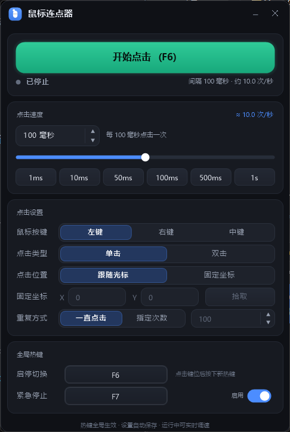

# 鼠标连点器 (Mouse Auto Clicker)

一个用 **C++ / Win32 API + GDI+** 编写的 Windows 鼠标连点器，纯自绘界面、无任何第三方运行时依赖，编译产物是单个绿色 exe。



---

## 一、快速开始

直接运行：

```
dist\鼠标连点器.exe        （中文名，便于识别）
dist\AutoClicker.exe        （同名副本，ASCII 名，便于脚本调用）
```

启动后默认按 **F6** 开始 / 停止点击。

---

## 二、功能

| 分类 | 功能 |
| --- | --- |
| **速度** | 1 ~ 3,600,000 毫秒任意设定；数字框可直接输入 / 滚轮微调 / 上下箭头步进；对数滑块 1ms~10s；6 个快捷预设（1ms/10ms/50ms/100ms/500ms/1s）；实时显示换算后的「次/秒」 |
| **按键** | 左键 / 右键 / 中键 |
| **点击类型** | 单击 / 双击（双击为一次间隔内连点两下，间隔 30ms） |
| **点击位置** | 跟随光标（在鼠标当前位置点击）/ 固定坐标（X、Y 可手输，也可用「拾取」按钮 3 秒后自动抓取光标位置） |
| **重复方式** | 一直点击，直到手动停止 / 指定次数（点够自动停止） |
| **全局热键** | 启停热键、紧急停止热键，**可自定义**：点击键位按钮后直接按下想要的组合键即可（支持 Ctrl / Alt / Shift / Win + 任意键），Esc 取消 |
| **状态显示** | 运行状态灯（呼吸效果）、点击次数、已用时长、实时点击速率 |
| **持久化** | 所有设置自动保存，下次启动自动恢复（含窗口位置） |

运行中修改速度、按键、位置等参数会**实时生效**，不会中断点击、也不会重置计数。

---

## 三、使用说明

### 界面分区

1. **主控区**：大按钮开始 / 停止（按钮上直接显示当前热键）；下方为状态、点击次数、用时、实际速率。
2. **点击速度**：毫秒输入框（可输入 / 滚轮 / 上下箭头）、对数滑块、快捷预设。
3. **点击设置**：鼠标按键、点击类型、点击位置、固定坐标（X/Y/拾取）、重复方式与次数。
4. **全局热键**：启停切换热键、紧急停止热键（可开关）。
5. **底部提示**：操作反馈与提示信息。

### 自定义热键

1. 点击「启停切换」或「紧急停止」右侧的键位按钮（显示当前热键）；
2. 按钮变为蓝色「按下新键…」，此时**直接按下想要的组合键**（例如 `Ctrl+F8`）；
3. 设置成功后立即生效并保存；若该组合已被其它程序占用会给出提示并保留原热键；
4. 按 `Esc` 可取消本次修改。

### 拾取坐标

1. 「点击位置」选择 **固定坐标**；
2. 点击 **拾取**；界面提示后窗口最小化，**3 秒内把鼠标移到目标位置**不要动；
3. 自动读取光标坐标并填回 X / Y，同时窗口恢复。

> 提示：固定坐标模式下运行时，连点器会持续把光标移到目标坐标。要停止请用**热键**（F6 或急停键），而不是去点界面按钮。

### 全局注意事项

- 热键为**系统级**，游戏、全屏程序内同样有效。
- 若目标程序以管理员权限运行，本程序也需要**以管理员身份运行**才能把点击送进去（Windows UIPI 限制）。
- 快捷键：空格键也可启停（未在编辑输入框时）。

---

## 四、配置文件

配置文件为 **绿色便携**模式，与 exe 同目录：

```
dist\MouseClicker.ini
```

若该目录不可写（例如放在 Program Files），会自动回退到：

```
%APPDATA%\MouseClicker\settings.ini
```

删除该文件即可恢复默认设置。

---

## 五、重新编译

项目自带完整的 MinGW-w64 工具链（见 `tools\w64devkit`），无需额外安装任何东西：

```powershell
# 在项目根目录执行（Windows PowerShell 需 Bypass 执行策略）
powershell -NoProfile -ExecutionPolicy Bypass -File .\build.ps1
```

脚本会自动定位工具链（依次查找：`-Toolchain` 参数 → `%W64DEVKIT%` → `tools\w64devkit` → `toolchain.path` → 常见路径），然后：

1. `windres` 编译资源（图标 + manifest）；
2. `g++ -std=c++20 -O2 -s -static -mwindows` 静态链接生成 exe；
3. 输出到 `dist\` 并生成中文名副本。

产物约 **720 KB**，单文件、无需运行库。

手动指定工具链：

```powershell
.\build.ps1 -Toolchain "D:\path\to\w64devkit"
```

---

## 六、目录结构

```
MouseClicker\
├─ README.md                 本文档
├─ build.ps1                 一键构建脚本
├─ src\                      源码
│   ├─ mc_common.h           基础层：主题配色、GDI+ 绘图辅助、DPI、字体、计时
│   ├─ mc_config.h           配置项与 INI 持久化、热键名称解析
│   ├─ mc_clicker.h          点击引擎：独立线程 + 高精度定时 + SendInput
│   ├─ mc_widgets.h          自绘控件库：按钮/分段选择/数字框/滑块/开关
│   ├─ mc_app.cpp            主程序：窗口、布局、绘制、交互、全局热键
│   ├─ app.rc / app.manifest 资源与清单（DPI 感知、请求 asInvoker）
│   ├─ app.ico / app.ico.b64 应用图标（含生成用的 base64 源）
├─ tools\                    工具（保留，便于下次修改）
│   ├─ w64devkit\            MinGW-w64 GCC 16.2 完整工具链（自包含）
│   ├─ fix-dsh-tls.ps1        DSH 因卡巴斯基 HTTPS 扫描导致 TLS 失败的修复脚本
│   └─ diag_api.js            DSH API 连通性诊断脚本
├─ dist\                     编译产物
├─ build\                    中间产物（.res）
├─ shots\                    界面截图（效果参考）
└─ tests\                    测试脚本
```

---

## 七、实现要点

- **点击注入**：`SendInput` 发送 `MOUSEEVENTF_*DOWN/UP`；固定坐标时用归一化的 `MOUSEEVENTF_ABSOLUTE | MOUSEEVENTF_VIRTUALDESK` 移动，支持多显示器。
- **定时精度**：`QueryPerformanceCounter` 计算绝对到期时刻（避免累积漂移）+ `timeBeginPeriod(1)` + 「粗睡（条件变量，最长 20ms 一段）+ 末段自旋」。实测 1ms 间隔可稳定跑出 **约 960~1000 次/秒**。
- **无卡顿停止**：睡眠是可中断的（条件变量通知），按下停止后 20ms 内响应。
- **实时改参**：点击参数由互斥量保护，工作线程每轮读取；速度变化时平滑重排节奏，计数不丢。
- **界面**：全部 GDI+ 自绘（圆角卡片、渐变按钮、对数滑块、带光标闪烁的数字输入框），双缓冲绘制，Per-Monitor V2 DPI 感知，Win11 自动圆角（DWM），非 Win11 回退 `SetWindowRgn`。
- **热键**：`RegisterHotKey` + `MOD_NOREPEAT`；进入捕获模式时先注销热键，保证按键能正常送达窗口。

---

## 八、已知限制

- 仅支持 Windows（Win7 SP1 及以上，推荐 Win10/11 x64）。
- 固定坐标模式会移动系统光标，这是「定点连点」的固有行为。
- 部分带内核级反作弊的网游会屏蔽 `SendInput` 类模拟点击，属于游戏侧限制。

---

## 九、常见问题：exe 无法运行（智能应用控制拦截）

> **本机状态（2026-09-21 已处理）**：已用管理员权限把 `VerifiedAndReputablePolicyState` 由 **1 改为 0**，**重启系统后**本机即可直接运行连点器 exe。
> 重启前若想立刻使用，请见第十一章的「脚本版」（无需任何权限，已验证可用）。

若双击/运行 exe 时报：

```
An Application Control policy has blocked this file
```

这是 Windows 11 的 **智能应用控制 (Smart App Control)** 处于**强制模式**所致（本机 `HKLM\SYSTEM\CurrentControlSet\Control\CI\Policy\VerifiedAndReputablePolicyState = 1`）。
该机制会阻止"未签名且云端信誉未知"的可执行文件——本地新编译的 exe 正好属于这一类（每次重新编译哈希都会变，需要重新评估信誉）。
事件日志可在 **事件查看器 → 应用程序和服务日志 → Microsoft → Windows → CodeIntegrity/Operational**（事件 3077 / 3033 / 3118）中看到拦截记录。

可选处理方式：

1. **关闭智能应用控制**：设置 → 隐私和安全性 → Windows 安全中心 → 应用和浏览器控制 → 智能应用控制 → 选择「关闭」。
   > ⚠️ 微软的限制：手动关闭后**无法再次开启**（除非重置或重装 Windows）。请自行权衡。
2. 在**没有开启**智能应用控制的电脑上运行本程序。
3. 使用受信任的**代码签名证书**对 exe 签名（自签名证书无效，SAC 不认）。

编译与源码本身不受影响，`build.ps1` 始终能正常产出 exe。

---

## 十、附：DSH Desktop 连不上 DeepSeek API 的修复

若出现 `DeepSeek API request to https://api.deepseek.com failed`，且本机安装了**卡巴斯基**（其"加密连接扫描"会对 HTTPS 做中间人替换），可用：

```powershell
powershell -NoProfile -ExecutionPolicy Bypass -File .\tools\fix-dsh-tls.ps1
```

脚本会导出卡巴斯基根证书 → 写入 DSH 数据目录 → 设置用户环境变量 `NODE_EXTRA_CA_CERTS` → 并用 DSH 自带 Electron 实测 5 次请求验证。**设置后需完全退出并重启 DSH Desktop** 才生效。

（根因详见 `tools\fix-dsh-tls.ps1` 头部注释。）

---

## 十一、脚本版（无需管理员权限，立即可用）

由于智能应用控制只拦截 PE 文件（exe/dll），而 `powershell.exe` 是系统签名的程序，因此本项目额外提供了一个**纯脚本实现**的连点器，用于在无法运行 exe 的环境下应急：

```
script-version\启动连点器.bat          ← 双击即可（推荐）
script-version\MouseClicker.ps1        ← 脚本本体
```

或手动运行：

```powershell
powershell -NoProfile -ExecutionPolicy Bypass -File .\script-version\MouseClicker.ps1
```

功能与 C++ 版对齐：间隔（毫秒）输入 / 预设 / 对数滑块、左中右键、单击双击、跟随光标 / 固定坐标（含拾取）、
一直点击 / 指定次数、可自定义的启停与急停全局热键、点击次数 / 用时 / 实时速率显示。
配置保存在 `script-version\ScriptClicker.ini`。

**实现方式**：脚本用 `Add-Type` 把内嵌的 C#（WinForms + P/Invoke `SendInput` / `RegisterHotKey`）编译到内存中运行——
编译产物不落盘，因此不会被智能应用控制检查。

> 说明：脚本版是应急/备用方案；正式交付仍是 C++ 版（体积更小、启动更快、界面为 GDI+ 自绘）。

