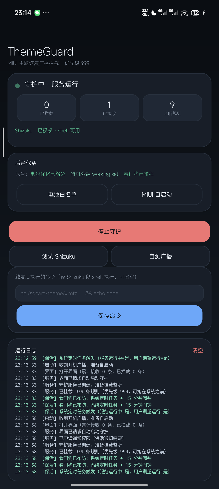

# ThemeGuard · MIUI 主题恢复拦截

一个只做一件事的小应用：**阻止 MIUI / HyperOS 在主题试用到期或被判定异常时，把主题恢复成默认**。
基于 adb / Shizuku 权限实现，**不需要 root，也不需要解锁 BL**。

- 开发与验证环境：Redmi K70 Ultra（`rothko`）/ 国行 HyperOS 3（`OS3.0.307.0.WNNCNXM`）/ Android 16
- 产物：[`dist/ThemeGuard-1.1-release.apk`](dist/ThemeGuard-1.1-release.apk)（versionName 1.1 / versionCode 2，已签名，无 debuggable）



## 一、原理：抢收 + 中断

MIUI 的主题试用 / 恢复走一条广播链路：

| 广播 | 含义 | 系统侧处理者 |
| --- | --- | --- |
| `miui.intent.action.CHECK_TIME_UP` | 主题试用到期检查 | `com.android.thememanager/.util.ThemeTrialReceiver` |
| `miui.intent.action.CLEAR_THEME_RUNTIME_DATA` | 清除主题运行数据 → 回落默认主题 | `com.android.thememanager/.service.ThemeTaskReceiver` |
| `com.android.thememanager.action.GET_MIBI` | 主题试用信息查询 | `ThemeTrialReceiver` |

应用在**运行时动态注册**这三个动作的接收器，并设置 `priority = 999`（最高优先级），抢在系统应用之前收到：

1. **第一道：拦截** —— 若该广播是**有序广播**，立刻 `abortBroadcast()`；后续接收器（含 thememanager 自己的）收不到，恢复流程被打断。实测：从 adb 发一条有序广播，本应用成功 `ABORTED`，同一条广播的后续接收者不再收到。
2. **第二道：兜底** —— 若广播是**普通广播**（系统不允许中断），弹一条高优先级通知告警，并通过 Shizuku 的 `rish` 以 shell 身份执行 `/sdcard/ThemeGuard/fallback.sh`：把 `theme-backup/*.mtz` 回注到 `Android/data/com.android.thememanager/files/theme/`，再拉起主题管理器提示应用。

> 只对上面三个「危险动作」执行兜底命令；`TIME_TICK` / 屏幕亮灭等心跳类动作只记录不触发，避免误执行。

## 二、为什么不是「禁用接收器」

直接禁用系统组件更干净，但 Android 14+ 起 shell 不允许改系统应用的组件状态。实测（HyperOS 3 / Android 16）：

```
pm disable com.android.thememanager/.service.ThemeTaskReceiver
→ SecurityException: Shell cannot change component state for ComponentInfo{...ThemeTaskReceiver} to 3

pm disable-user --user 0 com.android.thememanager
→ SecurityException: Cannot disable ...
```

Shizuku 的权限与 adb shell 等价，同样会被拒绝；要真正禁用只能 root。所以本应用走「抢收 + 中断 + 兜底」路线。

## 三、保活（HyperOS 上实测有效）

| 层级 | 做法 |
| --- | --- |
| 前台服务 | `GuardService` + `START_STICKY` + `android:stopWithTask="false"`（划掉后台不死） |
| 系统定时任务 | `JobScheduler` 周期任务（`setPersisted(true)`，15 分钟）——即便进程被杀，系统仍会再次拉起 |
| 闹钟兜底 | `AlarmManager` 15 分钟一次；服务被销毁时 10 秒后抢修 |
| 开机自启 | `BootReceiver` 监听 `BOOT_COMPLETED` / `LOCKED_BOOT_COMPLETED` |
| 系统侧 | Doze 白名单（`dumpsys deviceidle whitelist +<pkg>`）、待机分组 `active`（`am set-standby-bucket <pkg> active`） |
| MIUI 侧 | 自启动开关、省电策略「无限制」（App 内有按钮直达 MIUI 自启动页） |

App 内「后台保活」卡片会实时显示：电池优化是否豁免、当前待机分组（active/working set/frequent/rare/restricted，按档位着色）、看门狗是否已排程。

## 四、构建（不需要 Gradle / Android Studio）

需要：**JDK 17**、Android SDK **build-tools**（aapt2 / d8 / zipalign / apksigner）、**platform**（android.jar）。

```powershell
# 正式版
.\build.ps1 -Manifest AndroidManifest-release.xml -VersionCode 2 -VersionName 1.1 -ApkName ThemeGuard-1.1-release.apk

# 开发版（保留 android:debuggable，可用 run-as 抓日志）
.\build.ps1 -ApkName ThemeGuard-debug.apk
```

脚本流程：`aapt2 compile`（res/）→ `aapt2 link`（manifest + res + assets）→ `javac` → `d8` → 注入 `classes.dex` → `zipalign` → `apksigner`。
工具链路径在脚本顶部 `$tools` 处配置。

> 签名用的 `.jks` **不随仓库提供**（私钥不应入库，而且换密钥会导致无法覆盖安装）。首次构建会自动生成 `debug.jks`。

## 五、安装

HyperOS 对 adb 安装有额外限制，`adb install` 可能报 `INSTALL_FAILED_USER_RESTRICTED`，改用：

```bash
adb push ThemeGuard-1.1-release.apk /data/local/tmp/tg.apk
adb shell pm install -r -t -g --user 0 /data/local/tmp/tg.apk
```

也可以直接把 APK 拷到手机，用文件管理器点击安装。

首次运行请到 **Shizuku** 里允许本应用（App 内「测试 Shizuku」按钮可触发授权弹窗）。没有授权时**拦截仍然有效**，只是兜底命令不可用。

## 六、目录结构

```
android-theme-guard/
├── AndroidManifest.xml            开发版 manifest（debuggable）
├── AndroidManifest-release.xml    正式版 manifest（无 debuggable，中文应用名）
├── build.ps1                      构建脚本（aapt2 + javac + d8 + zipalign + apksigner）
├── assets/
│   ├── fallback.sh                兜底脚本（回注主题包并拉起主题管理器）
│   ├── backup.sh                  备份本地主题包到 /sdcard/ThemeGuard/theme-backup
│   ├── rish                       Shizuku 提供的远程 shell 入口（见「第三方」）
│   └── rish_shizuku.dex           同上
├── res/                           图标（自适应）、闪屏主题、配色
├── src/com/dsh/themeguard/
│   ├── GuardService.java          前台服务：动态注册 9 条广播规则，priority 999
│   ├── GuardJobService.java       JobScheduler 看门狗
│   ├── WatchdogReceiver.java      闹钟兜底
│   ├── BootReceiver.java          开机自启
│   ├── KeepAlive.java             保活编排（任务 / 闹钟 / 拉起服务）
│   ├── Guard.java                 动作表、中文日志、rish 调用、脚本部署
│   └── MainActivity.java          纯代码构建的卡片式界面（无 XML 布局）
├── shots/                         真机截图
└── dist/ThemeGuard-1.1-release.apk
```

## 七、已验证 / 已知限制

**已验证（真机）**

- 有序广播实测被成功 `abortBroadcast()`：日志 `[拦截] 自测广播 —— 已中断，系统应用收不到这条广播了`
- 广播过滤器确实注册在系统里（`dumpsys activity broadcasts` 可见 `BroadcastFilter`）
- 开机/更新后服务自动拉起；`am kill` 杀不掉持有前台服务的进程
- 兜底链路端到端跑通：`rish → sh /sdcard/ThemeGuard/fallback.sh → 退出码 0`
- 正式版与本地构建哈希一致（`sha256` 逐字节比对）

**已知限制**

- 能否真正拦下，取决于 MIUI 把 `CHECK_TIME_UP` 当**有序广播**还是普通广播；普通广播只能记录 + 兜底（App 日志会明确区分两者）
- 未 root 无法禁用系统组件、无法读写 `/data/system/theme`
- 兜底脚本需要你先把主题包 `.mtz` 放进 `/sdcard/ThemeGuard/theme-backup/`，否则只能告警

## 八、第三方与许可

- `assets/rish`、`assets/rish_shizuku.dex` 提取自 [Shizuku](https://github.com/RikkaApps/Shizuku)（Apache-2.0），仅用于让本应用以 shell 身份执行命令；版权归原作者所有。
- 本工程其余代码为自用工具，按「原样提供」发布，使用风险自负。
